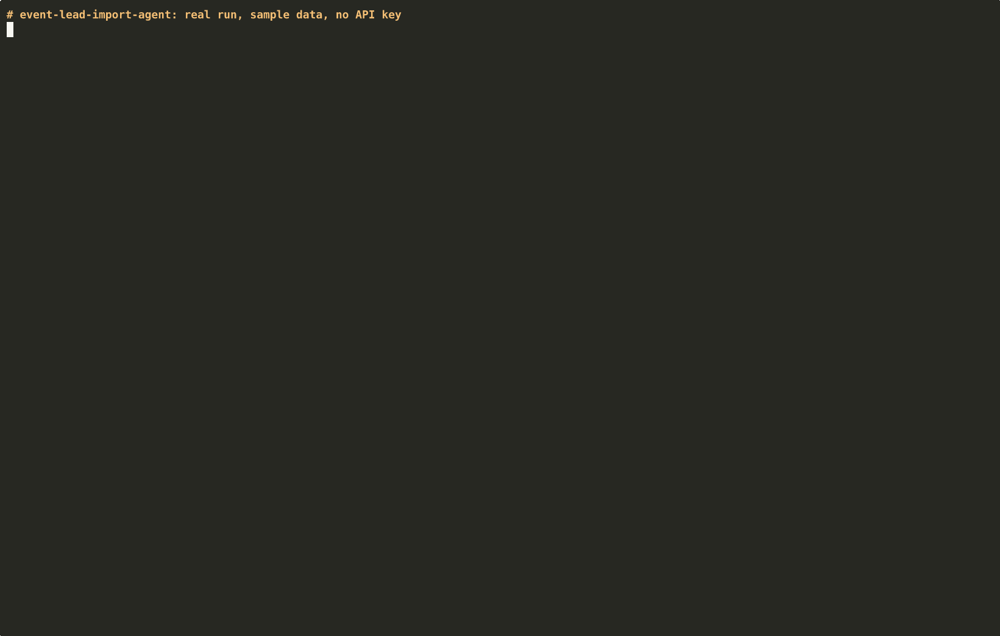

# Event Lead Import Agent

**Turn a messy post-event lead list into clean, deduplicated, CRM-ready import files, before it touches HubSpot or Salesforce.**

> Built by Rubia Naseem, GTM Engineer (12+ yrs CRM/RevOps, HubSpot & Salesforce).

---

## Demo



**[Watch the full 4-minute walkthrough (GitHub → terminal → review → HubSpot import → lead source)](docs/demo-hubspot.mp4)**

The video uses a demo HubSpot account with fictional sample contacts only.

---

## The pain point

Every conference ends the same way. Someone drops a badge-scan CSV in Slack, the columns don't match your properties, and it gets imported anyway. HubSpot creates "new" contacts that already existed, sales gets a cold list a week late, and Marketing Ops spends the next fortnight merging duplicates.

- *"Export badge scan CSV → reformat columns → dedupe manually → import → realize half of them got created as net new because of email capitalization issues → fix duplicates → … sales complains leads are cold → repeat at next conference."* ([r/hubspot: HubSpot lead import after conferences is broken](https://www.reddit.com/r/hubspot/comments/1rxpuhz/hubspot_lead_import_after_conferences_is_broken/))
- *"Importing ill-formatted data from a random spreadsheet is a recipe for incorrect lead scores and assignments,"* so a list-import template and a QA pass are essential. ([Sponge.io: How to Import a Marketing List without Screwing Up Your Data](https://sponge.io/how-to-import-a-marketing-list-without-screwing-up-your-data/))

---

## What it does

- **Cleans the list:** maps messy column headers, lowercases emails, splits `Name - Title`, fixes ALL-CAPS names and formats UK mobiles
- **Drops junk and dedupes:** removes blank and `TBD` rows and your own booth staff, and merges in-file duplicates with the *most restrictive* consent
- **Matches against your CRM:** exact email → `UPDATE`, same domain and surname under a different email → `REVIEW`, new person at a known account → `CREATE`
- **Guards the CRM:** flags existing Opportunities and Customers, catches invalid emails, and never treats blank consent as opt-in
- **Stamps lead source:** every update and create row gets `Recent Lead Source` = `Event` (change it with `--lead-source`)
- **Writes three import files plus a QA brief and sales handoff**, by Claude if you add a key, or by a template if you don't

---

## Where each step runs

1. **GitHub** holds the code. Clone it or click **Code → Download ZIP**.
2. **Terminal** is where you run it on your event CSV plus a CRM export. It works with no API key; with `ANTHROPIC_API_KEY` in `.env`, Claude writes the brief via the API, not the chat app.
3. **You, in a spreadsheet,** decide each row in `out/needs_review.csv`.
4. **HubSpot:** create the `recent_lead_source` property ([Lead source](docs/DETAILS.md#lead-source)), then import `import_update.csv` and `import_create.csv` with **Create and update**, matched on **Email**.
5. **Salesforce alternative:** load the same files with **Data Import Wizard**, or let HubSpot's Salesforce connector sync them (HubSpot Professional or Enterprise).

**The agent never writes to your CRM.**

---

## Quick start

```bash
git clone https://github.com/rubianaseem/event-lead-import-agent.git
cd event-lead-import-agent
python3 -m venv .venv && source .venv/bin/activate
pip install -r requirements.txt
python event_lead_import_agent.py          # runs on the sample data, no API key needed
```

Use your own files with `--events`, `--crm`, `--event-name` and `--internal-domains` (examples in [SETUP.md](SETUP.md)).

---

## Example output

On the sample data, with no API key:

```text
[CREATE] Priya Shah  <priya.shah@northwind-analytics.com>  Northwind Analytics  [HOT]
    - merged in-file duplicates (rows 2, 6)
    - new contact at a known account (northwind-analytics.com, Customer): route to Jordan Patel

[REVIEW] Marco Rossi  <marco.rossi@brightpath.co>  Brightpath
    - probable duplicate of Record 50102 (m.rossi@brightpath.co): confirm before import

IMPORT QA BRIEF: SaaS Ops Summit London 2026
8 raw rows -> 1 update, 2 create, 2 review, 2 dropped, 1 in-file duplicate(s) merged.
```

---

## More

- [SETUP.md](SETUP.md): virtual environment, sample run, API key, connecting real data sources, extending it, troubleshooting
- [docs/DETAILS.md](docs/DETAILS.md): all the pain-point quotes, full feature list and example output, cost, stack swap table, customising, [lead source](docs/DETAILS.md#lead-source) setup for HubSpot and Salesforce, how this runs today vs production, and what's in the repo
- [docs/demo-hubspot.mp4](docs/demo-hubspot.mp4) and [docs/lead-source-event.gif](docs/lead-source-event.gif): the demo video and lead-source GIF
